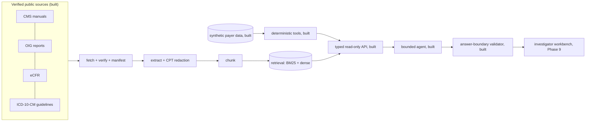

# Architecture

Status key: **built** (in the repo and tested), **planned** (phase noted). Nothing planned is
described as working.

## Principle

A human investigator decides. The system assembles and cites evidence; it never decides fraud,
denial, coverage, or medical necessity. Three layers, with the model last and least trusted.

## Layers

| Layer | Responsibility | Status |
|---|---|---|
| Source ingest | Fetch with a polite client, verify expected text and terms, hash, record in `SOURCES/manifest.jsonl`; extract page-anchored text; redact CPT descriptors and log by hash; chunk with section headings and page ranges | built (Phase 0) |
| Retrieval | BM25 (pure Python) and dense (`text-embedding-3-small`, cosine over a flat numpy index); gold-set evaluation by verbatim quote | built (Phase 0); hybrid, reranking, contextual embeddings planned (Phase 6) |
| Cost guard | Every paid call is priced, capped, refused if over a cap, and ledgered in `budget/ledger.jsonl` | built (bootstrap) |
| Synthetic data | Members, providers, claims, lines, flags with seeded anomalies and known ground truth, fake codes only | planned (Phase 2) |
| Deterministic tools | Edit checks, duplicate detection, code validation, billing-pattern statistics | built (Phase 3): `src/claims_copilot/tools/`, read-only, findings with references, no verdicts |
| API | FastAPI + Pydantic over the tools and BM25 policy search; read-only GET routes, typed responses separate from the tool records, `docs/openapi.json` snapshot, `GET /v1/tools` manifest derived from the schema; loopback only, no auth | built (Phase 4): `src/claims_copilot/api/` |
| Bounded agent | Plain tool-calling loop: at most 8 turns, 12 tool calls, 60 s, $0.15 per investigation; tools called through the in-process API from `GET /v1/tools`; one swappable adapter each for OpenAI and Anthropic over `httpx`; every model call through `CostGuard`; a record of every run | built (Phase 5): `src/claims_copilot/agent/` |
| Answer boundary | Scope gate before the model; evidence registry, schema, citation, quote, and verdict-word checks after (`ANSWER_BOUNDARY.md`) | built (Phase 5) |
| Observability and security | Tracing, audit log, PII/secret scanning, prompt-injection tests | planned (Phase 8) |
| Workbench UI | Investigator-facing evidence view | planned (Phase 9) |

## Trust boundaries

- Retrieved text, fetched web content, and provider output are untrusted data, never
  instructions.
- Citations must resolve to retrieved `chunk_id`s, and chunks resolve to a manifest entry, so
  every claim traces to a fetched, hashed source and page.
- The API opens only `payer.sqlite` (read-only, one connection per request), never imports the
  scorecard, and returns error bodies that name a parameter but never repeat its value. Policy
  search hits are labelled `untrusted` and resolve to a verified manifest row.
- Secrets live only in the gitignored `.env`; a Cursor hook blocks credentials in shell commands
  and gitleaks runs in pre-commit.
- Third-party source files and everything derived from them stay local and gitignored
  (`data/raw`, `cache`, `text`, `chunks`, `index`). The repository holds code, the manifest,
  hashes, and logs.

## Open decision gates

Each is presented to the owner with 2-3 options and a recommendation when its phase is reached.

| Gate | Asked in |
|---|---|
| Persistence | Phase 2 (decided: SQLite, two files; see `DECISIONS.md`) |
| API packaging | Phase 4 |
| Raw tool calling vs graph orchestration | Phase 5: raw loop chosen (`DECISIONS.md`) |
| Vector storage (flat numpy index is the Phase 0 baseline) | Phase 6 |
| Eval and judge policy | Phase 7 |
| Observability stack | Phase 8 |
| Frontend | Phase 9 |
| Deployment target (recommend AWS-compatible) | Phase 10 |
| License | Before publishing |
